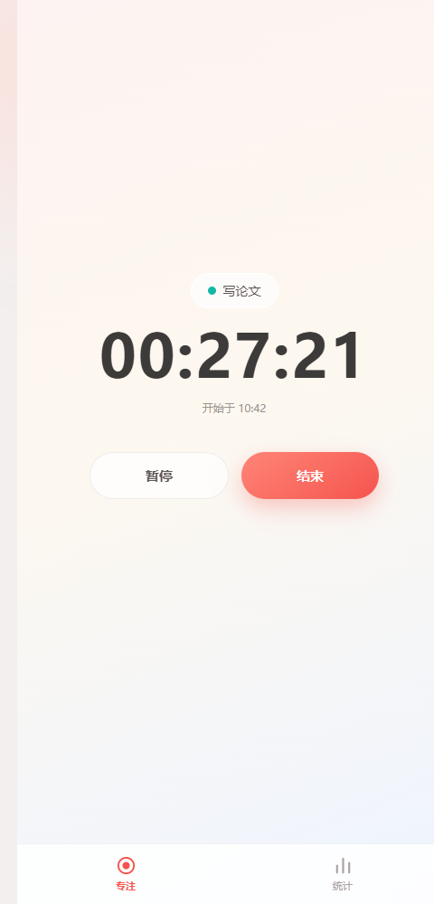
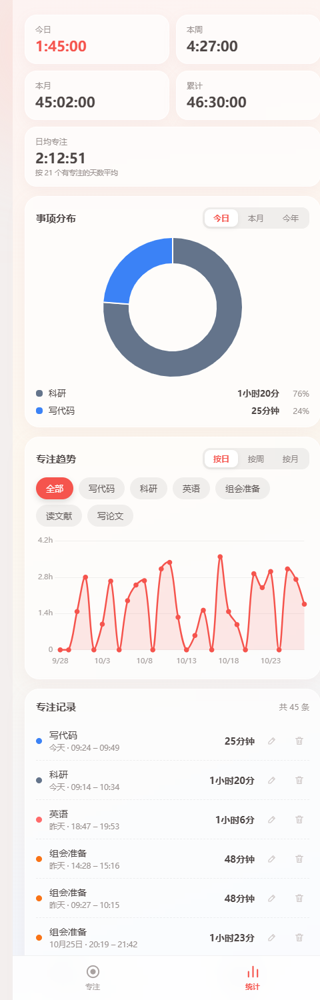
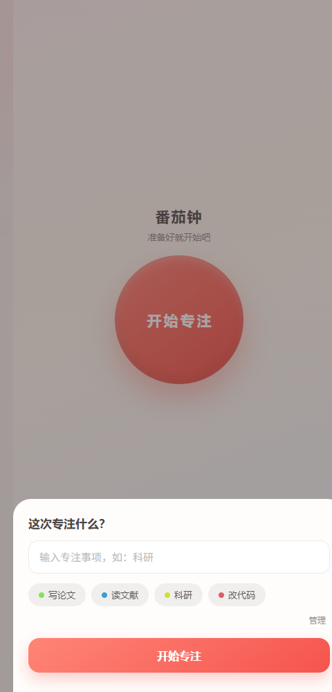
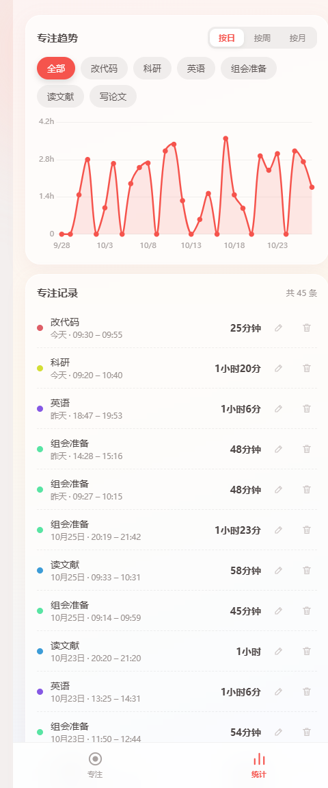
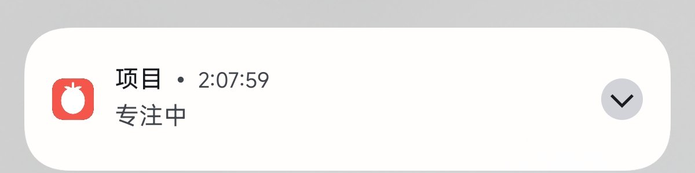

# 🍅 番茄钟（手机端 App）v1.4.0

仿「番茄ToDo」思路打造的极简专注计时 App：只保留**正计时专注**一种模式，专注完直接记录，没有休息倒计时。基于 Capacitor 打包成安卓 APK 安装在手机上使用，也可以直接在电脑浏览器里打开预览。

**全程离线、数据只存在自己手机上**：不声明联网权限、不声明存储/位置等权限、不联网上报、不开系统云备份。唯一的额外权限是 `VIBRATE`（普通系统权限，只用来做按钮的震动反馈，不碰任何数据）。

## 截图

> 截图用无头浏览器从 `www/` 真实渲染，数据为**示例数据**（注入 localStorage 生成，非真实使用记录）。

| 专注中 | 统计总览 |
|---|---|
|  |  |

| 开始弹层 | 专注趋势 + 记录 |
|---|---|
|  |  |

空闲态见 [docs/screenshots/focus-idle.png](docs/screenshots/focus-idle.png)，
备份与恢复见 [docs/screenshots/stats-backup.png](docs/screenshots/stats-backup.png)。

下面是**真机**上的通知栏计时卡（专注进行中，事项名 + 走秒时间）：



> 截图已裁掉系统状态栏。多数机型锁屏上会显示同样的卡片，个别 ROM 需要手动放行，见下方排查。

## 功能

**专注页（底部左 Tab）**
- 空闲时只有一个大按钮「开始专注」
- 点击后输入这次专注的事项，或从「最近事项」一键点选（同一事项颜色永远一致，**不同事项也不会撞色**）；点「管理」可删除/清空不需要的快捷事项
- 正计时走秒，支持「暂停/继续」（暂停的时间不计入专注时长）
- 点「结束」需二次确认，避免误停；**时长精确到秒**（1分46秒就记1分46秒，统计自动精确合计，不再舍弃不足1分钟的部分）
- **后台计时很稳**：时长按时间戳计算（`现在 - 开始 - 暂停累计`），切后台、锁屏甚至进程被杀，回来时间都准确；进程被杀后重开 App 会自动恢复进行中的专注
- **忘了点结束不会被判作废**：超过 12 小时还没结束的专注，重开 App 会保留下来，并在**屏幕顶部挂一条常驻提醒条**（不会像普通提示那样两秒就没了，右上角 × 可手动关掉）；点「结束」时也会警告「已持续 XX，可能忘了点结束」。时长记错了没关系，结束后去统计页编辑这条记录就能修正
- **「忘了点结束」只有一个判定口径**：顶部提醒条和结束弹层用的是同一个数（就是最终会记录下来的那个专注时长），不会出现「提示说 13 小时、记录却是 0 秒」这种自相矛盾

**通知栏计时卡**
- 专注期间有一条"进行中"常驻通知：事项名 + 走秒时间 + 「查看」按钮，点击回到 App（见上方真机截图）。**多数机型锁屏上也会显示同样的卡片**（与番茄ToDo 同机制），但这取决于厂商 ROM 是否放行锁屏通知，本项目无法代劳
- 暂停时时间冻结显示"已暂停"；结束卡片消失
- 首次开始专注会请求**通知权限**（Android 13+），允许后卡片才可见；不允许不影响计时本身
- 通知由 specialUse 前台服务驱动，**走字交给系统**：通知用 chronometer（起算点 = 开始时间 + 暂停累计）由 SystemUI 每秒绘制，所以本进程被后台冻结甚至回收时通知照样走秒，**不需要 WakeLock**；服务本身 60 秒一次心跳只为在进程重建或通知被系统清掉后按时间戳重算、自愈重发
- **锁屏看不到卡片？** 这是 ROM 设置问题、不是 App 的 bug，依次检查：① 启动计时后再锁屏；② 设置→通知与控制中心→锁屏通知→显示所有通知内容；③ 设置→应用→番茄钟→通知→「专注计时」渠道→锁屏=显示所有内容；④ MIUI 权限里「锁屏显示」=允许。通知栏能正常显示、只有锁屏没有时，基本就是这几处之一没开

**统计页（底部右 Tab）**
- 概览卡片：今日 / 本周 / 本月 / 累计 / 日均（精确到秒的时钟格式，如 `2:09`、`2:45:30`；日均 = 总专注时长 ÷ 有专注记录的天数，没专注的日子不会拉低平均值）
- 环形饼图：按专注事项聚合（自动合并同类项），可切换 今日 / 本月 / 今年，图下列表显示精确时长（`1分46秒`）与占比
- 趋势折线图：按日（近30天）/ 按周（近12周）/ 按月（近12月）看总时长变化，可按事项筛选（比如只看「科研」的趋势）
- 记录管理：记录列表可删除、可编辑（**事项名和时长都能改**，当时选错事项名或时长记错了改一次即可；跨零点拆分的同组记录会一并改名，改时长时按各条原占比分配、总时长精确守恒），更早的记录点「加载更早」继续查看
- **跨零点的专注自动按天拆分**：结束时按本地零点拆成两条记录，各段扣除落在该段内的暂停时间（总时长秒级守恒），「今天 / 昨天」等每日统计归属正确

**备份与恢复（统计页底部）**
- **导出数据**：把全部记录 + 快捷事项拼成一份 JSON，手机上点「保存到文件」会弹出**系统文件选择器**（用 SAF，不需要任何存储权限），自己选个位置存下（默认是「下载」）；电脑上则是直接下载
- **导入数据**：同样走系统文件选择器；也可以把 JSON 直接粘进输入框
- **导入按记录 id 合并**：同一条记录以导入的为准，本机独有的记录保留 —— **永远不会因为导入而删掉你已有的记录**
- **换机 / 重装 / debug 换 release 前导一份**：这三件事都会丢记录（localStorage 跟着 App 私有目录走），导一份就万无一失
- 导出的是**明文 JSON**，事项名和时长一眼能看见。传到网盘 / 聊天工具里之前自己掂量一下

## 在电脑上预览

最快：双击仓库根目录的 **`preview-web.bat`** —— 自动起本地服务并打开浏览器（端口占用会自动顺延）。F12 → Ctrl+Shift+M 切手机视口。

更省事：直接双击 `www/index.html`（Chrome/Edge 可用，Safari 对 `file://` 限制多）。

手动起服务：

```
python -m http.server 8848 --directory www
# 浏览器打开 http://127.0.0.1:8848
```

> `preview-web.bat` 用的是 8848 起、占用就顺延（避开 8899，那是同作者另一个项目长期占着的端口）。
> 网页预览和 App 数据不互通：网页存的是浏览器来源（origin）下的 localStorage，App 存的是 WebView 里的另一份。想在手机上验收请装 APK，见下。

## 只想用、不想装工具链

> ⚠ **目前 Releases 页面是空的，没有现成的 APK 可下载。**
> 本仓库没有配自动打包流水线 —— 自动发布必须把签名密钥的副本交给 GitHub 托管，
> 这里选择**不托管**，所以流水线保持关闭（原因见下方「签名密钥与自动发布」）。
> 想用的话有两条路：找作者要一个已签名的包，或者按下一节自己打一个（一条命令，缺什么工具脚本自动装）。

拿到 APK 之后的装法：

- 传到手机（数据线 / 微信文件传输助手 / 网盘都行），点安装；首次需要允许「未知来源」
- 装完记得在统计页「备份与恢复」里**导一份数据**（换机或重装前再导一次）

## 自己改代码、打包、装到手机

**只需要 Windows + PowerShell。** JDK 21、Android SDK、Gradle、Node.js 缺什么脚本自动装（装在 `%USERPROFILE%\tools\` 下，可重复运行，已装则复用），国内网络走镜像。Node 要求 ≥ v20。

```
powershell -ExecutionPolicy Bypass -File app\build-apk.ps1            # debug 包（日常用）
powershell -ExecutionPolicy Bypass -File app\build-apk.ps1 -Release   # release 包（首次自动生成签名）
powershell -ExecutionPolicy Bypass -File app\build-apk.ps1 -Install   # 打完直接装到已连线的手机
```

> ⚠ **脚本会改你本机的全局 Gradle 配置**：为了走国内镜像，它会写 `%USERPROFILE%\.gradle\init.gradle`。
> 这个文件对**本机所有 Gradle 工程**生效（包括你别的项目）。脚本发现内容不一致时会先备份成
> `init.gradle.bak`（已有同名备份则加时间戳）再覆盖，所以不会直接吞掉你的配置 ——
> 但如果你在里面加过私服 / 特殊仓库，覆盖后那些仓库就没了，记得从备份里捞回来。
> 介意的话可以先 `Remove-Item "$env:USERPROFILE\.gradle\init.gradle"` 或改脚本第 146 行那段镜像配置。

产物：原始的在 `app\android\app\build\outputs\apk\...`，脚本会**再复制一份带版本号的到 `_out\apk\`**（该目录已 gitignore）：

```
_out\apk\tomato-clock-1.4.0-debug.apk
_out\apk\tomato-clock-1.4.0-release.apk
```

装到手机的两种方式：

1. 把 `_out\apk\*.apk` 传过去点击安装（首次需允许「未知来源」）；
2. 手机开 USB 调试并连线后，一条命令：
   ```
   powershell -ExecutionPolicy Bypass -File app\install-to-phone.ps1
   ```

应用 ID 为 `app.tomato.clock`，与拾穗集互不冲突。**debug 与 release 签名不同，不能互相覆盖安装**。

装完请按 **[`docs/ACCEPTANCE.md`](docs/ACCEPTANCE.md)** 逐条验收（build-apk.ps1 末尾也会提示）。

### 签名密钥与自动发布（重要）

- `-Release` 首次会在 `app\android\` 下生成 `tomato-release.keystore` 与 `keystore.properties`（随机 24 位口令）。
- **这两个文件都不在 git 里**（`.gitignore` 已排除），请自己另找地方备份 —— 丢了就只能卸载重装，旧记录会清空。
- `app\android\app\build.gradle` 只在 `keystore.properties` 存在时才声明签名配置；脚本会在开打前校验四个字段齐全、密钥文件在位，避免「打出来才发现没签名」。
- **同一把钥匙必须签所有版本**：换了钥匙，用户装的新包就盖不住旧包（系统直接拒绝安装），只能卸载重装 —— 而记录全在 localStorage 里，卸载一次就没了。

#### 自动发布当前是关闭的

仓库里**没有** `.github/workflows/release.yml`，推 `v*` 标签不会触发任何自动打包。原因很直接：

自动打包要在 GitHub 的机器上签名，而签名密钥不能进仓库（仓库是公开的）。唯一的办法是把本机那把
密钥的副本传成 GitHub Actions secrets —— 这等于**把自己 App 的签名权分一份给 GitHub**：不公开、
只有仓库管理员能读，但任何能往这个仓库 push 的人，都能用这把密钥签出一个「看起来是你的番茄钟」的包。
这个项目选择不托管，所以流水线保持关闭；`app/setup-release-secrets.ps1` 也一并失去用途
（文件留着没删 —— 将来真要开自动发布，正好是它派上用场）。

#### 所以发布新版本走本机

```
powershell -ExecutionPolicy Bypass -File app\build-apk.ps1 -Release
```

包在 `_out\apk\tomato-clock-<版本>-release.apk`，手动传到
[Releases 页面](https://github.com/woluoleiqingxvlingsui/tomato_clock/releases) 即可。

> 将来如果改主意要开自动发布：`.github/workflows/release.yml` 还在 git 历史里
> （`git log --all --diff-filter=D -- .github/workflows/release.yml` 能找到删掉它的那次提交），
> 取回来后先把密钥上传成 4 个 secret（`KEYSTORE_BASE64` / `KEYSTORE_PASSWORD` / `KEY_ALIAS` /
> `KEY_PASSWORD`，`app/setup-release-secrets.ps1` 就是干这个的），再推 `v<版本>` 标签。

## 从零克隆后怎么跑

`app\android\` 里有两处是 **Capacitor 生成的、不进 git** 的东西（`capacitor-cordova-android-plugins/`、`app\src\main\assets\public\`），而 gradle 配置硬引用它们。所以新克隆的仓库**不能直接用 Android Studio 打开**，需要先让 Capacitor 生成一次：

```
cd app
npm install        # 脚本里会自动做，且优先用 npm ci 严格按 lockfile 装
npx cap sync android
```

其实直接跑 `app\build-apk.ps1` 就行——它把上面这套连同工具链一起自动化了。

## 目录结构

```
tomato_clock/
├── www/                        # App 界面层（会被打进 APK）
│   ├── index.html              # 全部界面与逻辑（单文件，移动优先）
│   ├── chart.umd.js            # Chart.js 4.5.1 本地文件（离线可用）
│   └── CHART.JS-LICENSE.md     # Chart.js 的 MIT 许可原文
├── app/                        # 安卓壳（Capacitor 7）
│   ├── capacitor.config.json
│   ├── build-apk.ps1           # 一键装工具链 + 打包（debug / release / -Install）
│   ├── install-to-phone.ps1    # adb 一键装机
│   ├── setup-release-secrets.ps1 # 把签名密钥传成 GitHub Actions secrets（自动发布关闭中，暂不用）
│   ├── preview-web.ps1         # 本地起服务预览网页版
│   ├── package.json            # Capacitor 依赖与版本号
│   └── android/                # 安卓工程（cap add 生成）
│       └── app/src/main/java/app/tomato/clock/
│           ├── MainActivity.java       # 窗口 / 边距（键盘、状态栏）处理
│           ├── TimerServicePlugin.java # 通知栏计时卡的 JS 入口
│           ├── TimerNotifyService.java # 前台服务，走字交给系统 chronometer
│           └── DataTransferPlugin.java  # 备份/恢复：系统文件选择器（SAF）
├── docs/
│   ├── ACCEPTANCE.md           # 装机验收清单 + 已知限制
│   └── screenshots/            # README 顶部引用的 6 张截图（见目录内说明）
├── legacy/                     # 旧桌面网页版（倒计时版），仅留档
├── preview-web.bat             # 双击预览网页版
├── LICENSE                     # MIT
└── README.md
```

## 数据与隐私

- 数据存在 App 私有的 localStorage（键：`tomato.sessions` / `tomato.ongoing` / `tomato.recentTasks`），**只在本机**，卸载 App 才会清掉
- 清单里**刻意没有** `INTERNET` 权限：Capacitor 的 `https://localhost` 由原生 scheme handler 在内存里拦截、直接从 APK 资源读文件，不监听任何端口也不发任何网络请求，所以完全不需要联网权限
- 清单里唯一的额外权限是 `VIBRATE`（普通系统权限，只用于按钮的震动反馈，不碰任何数据）。**备份 / 恢复走 SAF（系统文件选择器），不需要存储权限** —— App 不碰外部存储路径，保存位置由你自己选
- 清单里 `android:allowBackup="false"`：明确关掉系统备份，专注记录不会被传到 Google/云端。（注意删掉这行等于 true —— 官方默认值就是 true，要关必须显式写 false。Android 12+ 即便写了 false，部分厂商仍允许换机时的本机设备间迁移，那不出设备。）
- 没有账号、没有登录、没有埋点、没有任何第三方 SDK（除本地打包的 Chart.js）
- **备份 / 迁移：统计页「备份与恢复」可导出 / 导入 JSON**，文件由你自己保管，不经过任何服务器
- 旧桌面版（`legacy/index.html`）的倒计时记录**只有在新旧两版同源时**才会自动合并——也就是在同一个本地服务下先开 `legacy/index.html` 再开 `www/index.html`。App 装到手机上后跑的是 WebView 的 `https://localhost` 另一个来源，读不到桌面浏览器的数据，所以手机上装 App 并不会自动继承旧版记录。

## 已知限制

- **换包型（debug ↔ release）仍需卸载重装**（两者签名不同），会丢记录 —— 换之前先在统计页「备份与恢复」导一份数据
- 通知卡可见性依赖厂商 ROM 的锁屏通知设置，MIUI 上尤其容易需要手动放行
- **导出的 JSON 是明文**，事项名和时长一眼能看见；传到网盘 / 聊天工具之前自己掂量
- **前台服务用的是 `specialUse` 类型**（为了绕开 `dataSync` 6 小时硬超时）。直装 APK 完全没问题；但若要上架 Google Play，`specialUse` 需要提交用途说明并通过审核

## 相关项目

同一个人做的另一个本地单机小工具，顺手打个广告：

- 🧺 [**拾穗集**](https://github.com/woluoleiqingxvlingsui/shisuiji) —— 科研/办公备忘录：记赛博鸡蛋、论文待读已读归档与阅读笔记、网页收藏与读后要点、学习办公开销账单与体感评价。同样本地单机、Node 标准库 + Vue3 零依赖、双击即用、数据存 JSON。番茄钟的安卓打包流水线就是从它那儿沿用过来的。

## 许可

本项目代码 MIT（见 [`LICENSE`](LICENSE)）。`www/chart.umd.js` 是 Chart.js v4.5.1，MIT，许可原文在 `www/CHART.JS-LICENSE.md`。
