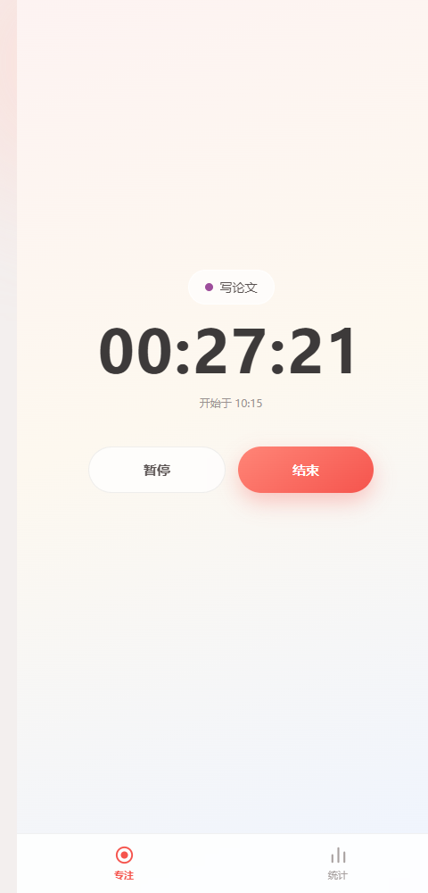
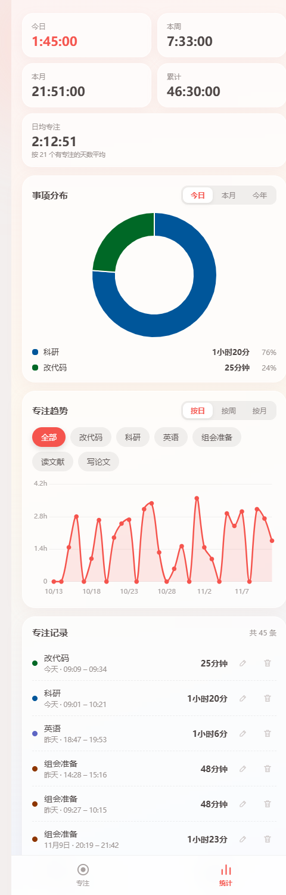
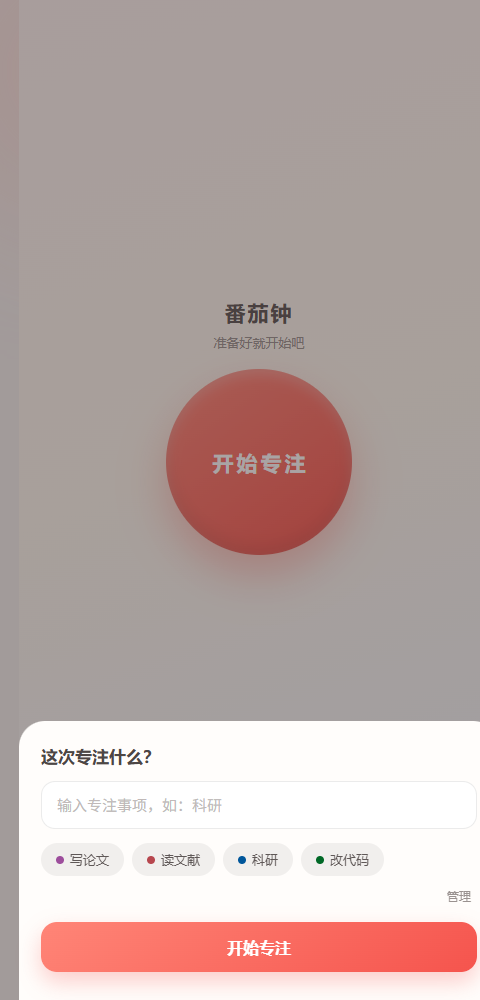
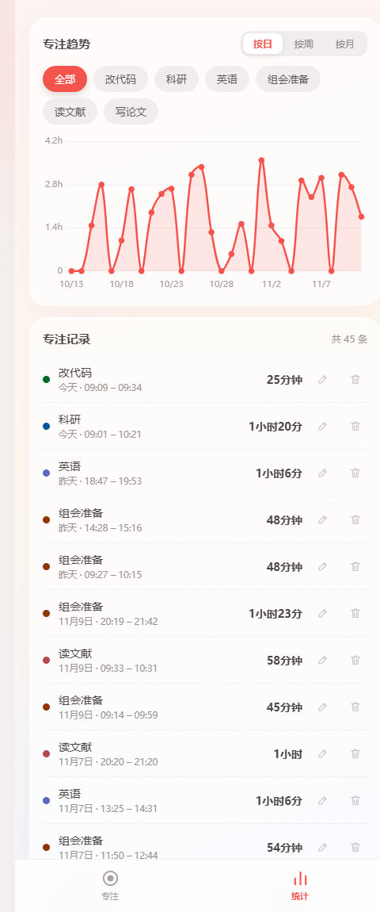
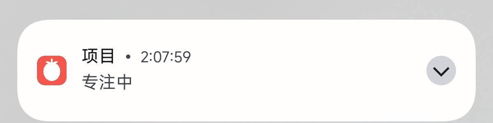

# 🍅 番茄钟（手机端 App）v1.5.0

仿「番茄ToDo」思路打造的极简专注计时 App：只保留**正计时专注**一种模式，专注完直接记录，没有休息倒计时。基于 Capacitor 打包成安卓 APK 安装在手机上使用，也可以直接在电脑浏览器里打开预览。

**全程离线、数据只存在自己手机上**：不声明联网权限、不声明存储/位置权限、不联网上报、不开系统云备份。除 `VIBRATE`（震动反馈）外，清单里只有通知栏计时卡必需的三项：`POST_NOTIFICATIONS`（Android 13+ 才弹，拒绝也不影响计时）、`FOREGROUND_SERVICE`、`FOREGROUND_SERVICE_SPECIAL_USE` —— 都不涉及联网、存储或位置。

**最低系统版本：Android 6.0（API 23）**；`targetSdk 35`。桌面浏览器预览需要任意现代浏览器（Chrome / Edge / Firefox / Safari）。

## 截图

> 截图用无头浏览器从 `www/` 真实渲染，数据为**示例数据**（注入 localStorage 生成，非真实使用记录）。

| 专注中 | 统计总览 |
|---|---|
|  |  |

| 开始弹层 | 专注趋势 + 记录 |
|---|---|
|  |  |

空闲态见 [docs/screenshots/focus-idle.png](docs/screenshots/focus-idle.png)，
备份与恢复见 [docs/screenshots/stats-backup.png](docs/screenshots/stats-backup.png)。

下面是**真机**上的通知栏计时卡（专注进行中，事项名 + 走秒时间）：



> 截图已裁掉系统状态栏。锁屏上能不能看到同样的卡片取决于厂商 ROM 是否放行锁屏通知，个别 ROM 需要手动放行，见下方排查。

## 功能

**专注页（底部左 Tab）**
- 空闲时只有一个大按钮「开始专注」
- 点击后输入这次专注的事项，或从「最近事项」一键点选（**协调色板**：14 个颜色按感知距离挑过，两个不同事项不会撞成同一个颜色；同一事项在本机各处保持同色，事项特别多时颜色仍可能接近）；点「管理」可删除/清空不需要的快捷事项
- 正计时走秒，支持「暂停/继续」（暂停的时间不计入专注时长）
- 点「结束」需二次确认，避免误停；**时长精确到秒**（1分46秒就记1分46秒，统计自动精确合计，不再舍弃不足1分钟的部分）
  - ⚠ 唯一的例外是**整次专注不足 1 秒**：这时不生成任何记录，结束时提示「本次没有产生记录」。不足 1 分钟但超过 1 秒的都会照记
- **计时与日历校时分开**：Android 使用包含休眠时间的单调计时基准，暂停时间单独扣除；同次开机内进程被回收后可继续恢复。手机重启、计时基准不可用，或浏览器重新加载页面后无法连续验证的时间，会保留会话并明确提示核对估算时长。前提是本机存储没有被清掉（清 App 数据 / 卸载会丢）。浏览器使用单调计时，但部分平台休眠期间可能停止推进；出现基准差异时同样应核对。
- **系统时间调整**：发现明显校时后会持续提醒核对；这次专注沿用开始时的连续时间轴记账，请核对日期与时长。需要核对的记录带有提示，编辑并确认时长后可清除提示。
- **忘了点结束不会被判作废**：超过 12 小时还没结束的专注，重开 App 会保留下来，并在**屏幕顶部挂一条常驻提醒条**（不会像普通提示那样两秒就没了，右上角 × 可手动关掉）；点「结束」时也会警告「已持续 XX，可能忘了点结束」。时长记错了没关系，结束后去统计页编辑这条记录就能修正
- **「忘了点结束」只有一个判定口径**：顶部提醒条和结束弹层用的是同一个数（就是最终会记录下来的那个专注时长），不会出现「提示说 13 小时、记录却是 0 秒」这种自相矛盾

**通知栏计时卡**
- 专注期间有一条"进行中"常驻通知：事项名 + 走秒时间 + 「查看」按钮，点击回到 App（见上方真机截图）。**锁屏上能不能看到同样的卡片，取决于厂商 ROM 是否放行锁屏通知**（MIUI 尤其容易需要手动开），本项目无法代劳；**通知栏里的卡片在多数机器上会出现，但同样受系统通知开关、省电策略和厂商 ROM 影响 —— 本项目没有在所有 ROM / 所有系统版本上验证过，不能保证每一台机器都能看到**
- 暂停时时间冻结显示"已暂停"；结束卡片消失
- 首次开始专注会请求**通知权限**（Android 13+），允许后卡片才可见；不允许不影响计时本身
- 通知由 specialUse 前台服务驱动，**走字交给系统**：通知用 chronometer，由 SystemUI 绘制；服务使用包含休眠时间的计时基准恢复时长，**不需要 WakeLock**。服务每 60 秒重发校正，校时与时区变化时也会更新。不同 ROM 的后台与通知行为仍需真机验收。
- **锁屏看不到卡片？** 多数情况是厂商 ROM 的锁屏通知设置，按这四项依次检查：① 启动计时后再锁屏；② 设置→通知与控制中心→锁屏通知→显示所有通知内容；③ 设置→应用→番茄钟→通知→「专注计时」渠道→锁屏=显示所有内容；④ MIUI 权限里「锁屏显示」=允许。通知栏能正常显示、只有锁屏没有时，多半是这几处之一没开。**这四项都正常还是看不到，也可能是 ROM 的其它策略、系统版本差异或本项目的实现问题 —— 本项目无法代劳，也没有在所有 ROM 上验证过**，请连同机型和系统版本一起反馈

**统计页（底部右 Tab）**
- 概览卡片：今日 / 本周 / 本月 / 累计 / 日均（精确到秒的时钟格式，如 `2:09`、`2:45:30`；日均 = 总专注时长 ÷ 有专注记录的天数，没专注的日子不会拉低平均值）
- 环形饼图：按专注事项聚合（自动合并同类项），可切换 今日 / 本月 / 今年，图下列表显示精确时长（`1分46秒`）与占比
- 趋势折线图：按日（近30天）/ 按周（近12周）/ 按月（近12月）看总时长变化，可按事项筛选（比如只看「科研」的趋势）
- 记录管理：记录列表可删除、可编辑（**事项名和时长都能改**，当时选错事项名或时长记错了改一次即可；跨零点拆分的同组记录会一并改名，改时长时按各条原占比分配、总时长毫秒级守恒），更早的记录点「加载更早」继续查看
  - 列表每次显示**最近 30 条**，点「加载更早」再各多 30 条
- **编辑只改专注时长，不动时间本身**：改完之后每条记录的**开始时间、结束时间、所属日期都保持原样**（不会拿新时长反推结束时间）。按原占比分配后如果某一段会超出它原来的时间区间，这一次修改**整体不生效**并给出提示 —— 不会把多出来的时长挪到别的日期去
- **手动改时长有 24 小时上限**：填超过 24 小时会被拦下并提示「时长最多 24 小时」，此时**名称也不会被改**（不留下改了一半的状态）
- **跨零点的专注自动按天拆分**：结束时按本地零点拆成多条记录，各段扣除落在该段内的暂停时间（各段之和 = 本次净专注时长，毫秒级守恒），「今天 / 昨天」等每日统计归属正确

**几个容易撞上的边界行为**
- **跨午夜 / 回到前台 / 改系统时区，统计页会重新按本地日历天归类**：日期归属按"本地日历天"切分；跨零点的专注仍按天拆成多条、各段之和 = 本次净专注时长；改时区后「今日 / 本月」的归属跟着新的本地时间走（已经记下来的记录里的 `date` 不会被偷偷改写）
- **导入失败不会把窗口清空**：解析或写盘失败时，导入窗口里粘的内容会留着让你改一改再试，并明确提示失败原因；记录导入成功但**快捷事项**没存上的，会**单独**提示，不会混在「导入完成」里
- **老版本留下来的「进行中」会话（没有暂停明细）**：暂停时长照样累计（暂停的时间不会被算成专注时长）；这类会话结束时归成**一条**记录，日期按**开始那天**算
- **恢复与校时需要核对的情况**：手机重启、浏览器重开页面或计时源变化时，保留会话并明确标记估算；明显校时会显示核对提示。单纯修改时区会更新统计范围，不改变已计量的专注时长。

**备份与恢复（统计页底部）**
- **导出数据**：把全部记录 + 快捷事项拼成一份 JSON，手机上点「保存到文件」会弹出**系统文件选择器**（用 SAF，不需要任何存储权限），自己选个位置存下（默认是「下载」）；电脑上则是直接下载
- **导入数据**：同样走系统文件选择器；也可以把 JSON 直接粘进输入框。为防止误选超大文件导致内存耗尽，文件导入上限为 **10 MiB**（正常备份远小于此）
- **导入按记录 id 合并**：同一条记录以导入的为准，本机独有的记录保留 —— **永远不会因为导入而删掉你已有的记录**
- **换机 / 重装 / debug 换 release 前导一份**：这三件事都会丢记录（localStorage 跟着 App 私有目录走）。导一份能把**已完成的记录**带走；**备份里不含正在进行中的专注** —— 迁移或卸载前先把这次专注结束掉、确认提示「已记录专注」再导出
- 导出的是**明文 JSON**，事项名和时长一眼能看见。传到网盘 / 聊天工具里之前自己掂量一下
- 备份里**不含事项配色映射**：换机后会按同一套色板重新分配，具体颜色可能与旧机不同；同一事项在新机各处仍保持同色

## 三种入口，先对号入座

| 你想做什么 | 走哪条路 | 要准备什么 |
|---|---|---|
| **普通用户**：在手机上用 | 拿一个已签名的 APK 装到手机（见下「只想用、不想装工具链」） | 手机 + APK，不用装任何工具链 |
| **想在电脑上看效果** | 双击 `preview-web.bat`（或手动起本地服务） | 浏览器；Python 可选 |
| **开发者**：改代码、打包 | `app\build-apk.ps1` | Windows + PowerShell，JDK / Android SDK / Gradle / Node 脚本自动装 |

## 在电脑上预览

最快：双击仓库根目录的 **`preview-web.bat`** —— 自动起本地服务并打开浏览器（端口占用会自动顺延）。F12 → Ctrl+Shift+M 切手机视口。

更省事：直接双击 `www/index.html`（Chrome/Edge 可用，Safari 对 `file://` 限制多）。

手动起服务（**务必带 `--bind 127.0.0.1`**，只让本机能访问）：

```
python -m http.server 8848 --bind 127.0.0.1 --directory www
# 浏览器打开 http://127.0.0.1:8848
```

> 不写 `--bind` 的话，Python 会监听 `0.0.0.0`，同一个局域网里的其它设备也能访问这个服务。
> `.gitignore` **不是访问控制**：它只是让 Git 不跟踪那些文件，文件还在磁盘上，HTTP 服务照样会发出去。
> `preview-web.ps1` 本身绑的就是回环地址，端口占用会自动顺延（避开 8899，那是同作者另一个项目长期占着的端口）。
> 网页预览和 App 数据不互通：网页存的是浏览器来源（origin）下的 localStorage，App 存的是 WebView 里的另一份。想在手机上验收请装 APK，见下。
> 多个标签页同开时的行为分两种：
> **① 浏览器提供 Web Locks 时**（http/https 页面，桌面 Chrome / Edge 实测）：写入走跨页面互斥锁，
> 两个页面各记各的不会互相覆盖，删掉的记录也不会被旧页面复活；同一条记录被两个页面同时改会提示冲突、要求刷新后重试。
> **② 浏览器不提供 Web Locks 时**（例如直接双击打开的 `file://` 页面）：App 退化成**单写页面模式** ——
> 竞选出唯一的一个可写页面，其它页面进入只读并提示你去那个页面操作；可写页面关掉后，只读页面会自动接手写权限。
> 写权限靠**盘上的租约**判定，每 1.5 秒续租一次、租约最长 6 秒：页面被冻结/挂起时续租会停，
> 租约过期后别的页面就能接管；**旧页面恢复时，它的写入会被拒绝**（不会拿过期身份覆盖接管方的数据）。
> 副作用：刚关掉写权限页面后，新开的页面可能要等几秒（最多约 7 秒）才能拿到写权限。
> ⚠ 第 ② 条是在桌面 Chrome 里**禁用 `navigator.locks` 后实测**的；
> **Android WebView（App 里跑的 `https://localhost`）是否提供 Web Locks 未在真机验证** —— 若不提供，
> App 会按同一套能力检测自动切到单写页面模式。

## 只想用、不想装工具链

> ✅ **[Releases 页面](https://github.com/woluoleiqingxvlingsui/tomato_clock/releases) 已有可直接下载的正式签名包**：
> 进页面下载 `tomato-clock-<版本>-release.apk`，传到手机点安装就行。
> 本仓库**没有**配自动打包流水线 —— 自动发布必须把签名密钥的副本交给 GitHub 托管，
> 这里选择**不托管**，所以流水线保持关闭（原因见下方「签名密钥与自动发布」）。
> Release 里的包是作者在本机打好、手动上传的，用的是作者自己那把签名密钥。
> 也可以按下一节自己打一个（一条命令，缺什么工具脚本自动装）。

拿到 APK 之后的装法：

**v1.5.0 当前为[预发布版本](https://github.com/woluoleiqingxvlingsui/tomato_clock/releases/tag/v1.5.0)**：自动回归、Android 单元测试和签名打包已通过，真机验收仍待完成。正式稳定版本目前为 v1.4.0。试用新版前请先导出数据备份，并下载同页的 `.sha256` 文件核对 APK。

- 传到手机（数据线 / 微信文件传输助手 / 网盘都行），点安装；首次需要允许「未知来源」
- **release 包之间可以直接覆盖安装升级，记录不会丢**（同一把密钥签名）；但升级前还是建议先导一份备份
  - ⚠ 这条说的是**同一把钥匙**打出来的包。自己用 `-CreateSigningKey` 签的包是**另一把钥匙**，
    和作者发布的包**不能互相覆盖安装**（系统会直接拒绝）—— 换包前先导一份备份
- **换机、重装、或把 debug 包换成 release 包都会丢记录** —— 这几种情况**一定先导一份数据**（debug 与 release 签名不同，不能互相覆盖）

## 自己改代码、打包、装到手机

**只需要 Windows + PowerShell。** JDK 21、Android SDK、Gradle、Node.js 缺什么脚本自动装（装在 `%USERPROFILE%\tools\` 下，可重复运行，已装则复用）。

> **两个 Node 版本要求不一样，别混**：
> - **打包**（`build-apk.ps1`）：Node ≥ v20（Capacitor CLI 的要求）。
> - **回归测试**（`tools\regression\browser-tests.js`）：Node ≥ **22** —— 脚本用 Node 内置的 `WebSocket`
>   连 Chrome 的调试端口，Node 20 默认没有开启这个全局对象，直接跑会报 `WebSocket is not defined`。

```
powershell -ExecutionPolicy Bypass -File app\build-apk.ps1            # debug 包（日常用）
powershell -ExecutionPolicy Bypass -File app\build-apk.ps1 -Release   # release 包（复用已有签名）
powershell -ExecutionPolicy Bypass -File app\build-apk.ps1 -Install   # 打完直接装到已连线的手机
```

> ⚠ **`-Release` 不再自动生成签名了。** 默认行为是**复用**已有的
> `app\android\tomato-release.keystore` + `app\android\keystore.properties`。
> 第一次自己签发要**显式**加 `-CreateSigningKey`（只做这一次，之后一直复用同一把钥匙）：
> ```
> powershell -ExecutionPolicy Bypass -File app\build-apk.ps1 -Release -CreateSigningKey
> ```
> 两个文件**只存在一个**时脚本会直接停下（让你从备份恢复），**即使加了 `-CreateSigningKey` 也不会补建** ——
> 少一半就补，等于悄悄换了一把新钥匙，手机上的旧包就盖不住了。

**首次构建要下的东西（心里有个数，别以为卡死了）**：Node ≈ 30 MB、JDK 21 ≈ 190 MB、Android cmdline-tools ≈ 130 MB、SDK platform + build-tools ≈ 800 MB、Gradle ≈ 130 MB —— **合计约 1.3～1.5 GB**，国内网络下**十几分钟**很正常。之后再跑就只增量编译，通常一两分钟。所有东西都落在 `%USERPROFILE%\tools\`，不污染系统目录。

**国内网络都走镜像，且每个工具都有回退源**（某一个源挂了会自动换下一个）：

| 工具 | 首选 | 回退 |
|---|---|---|
| Node.js | 淘宝 npmmirror | nodejs.org 官方 |
| JDK 21 | 华为云 openjdk 镜像 | Adoptium 官方 API |
| Android cmdline-tools | 腾讯云 AndroidSDK 镜像 | dl.google.com 官方 |
| Gradle | 腾讯云 → 华为云 → 官方 | 三个依次回退 |
| npm 依赖 | registry.npmmirror.com | registry.npmjs.org 官方 |

> Node / JDK / Android cmdline-tools / Gradle 的压缩包都会在解压前做 **SHA-256 完整性校验**，校验不一致直接换源或停止，不再只凭文件大小判断下载是否可信；Gradle Wrapper 也固定了同一发行包的 `distributionSha256Sum`。
> npm 这一条是**用 `--registry` 参数临时指定的**：脚本不会改你的全局 `~/.npmrc`，也不会往仓库里塞 `.npmrc`。
> 你自己 `npm install` 时的 registry 设置不受影响。

> ⚠ **脚本不会再动你本机的全局 Gradle 配置**：国内镜像写成项目内的 `app\android\mirrors.init.gradle`，构建时用 `--init-script` 只对这一次构建生效。
> `%USERPROFILE%\.gradle\init.gradle` 对**本机所有 Gradle 工程**生效，脚本不碰它，也不需要你去删它。
> 如果你自己在全局 init.gradle 里配过私服 / 特殊仓库，它照常生效（构建时两边的配置会叠加）。

产物：原始的在 `app\android\app\build\outputs\apk\...`，脚本会**再复制一份带版本号的到 `_out\apk\`**（该目录已 gitignore）：

```
_out\apk\tomato-clock-1.5.0-debug.apk
_out\apk\tomato-clock-1.5.0-release.apk
```

装到手机的两种方式：

1. 把 `_out\apk\*.apk` 传过去点击安装（首次需允许「未知来源」）；
2. 手机开 USB 调试并连线后，一条命令：
   ```
   powershell -ExecutionPolicy Bypass -File app\install-to-phone.ps1
   ```

> ⚠ 第 2 种方式有前置条件：手机「设置 → 关于手机 → 连点版本号 7 次」开开发者选项 → 打开 USB 调试，
> 首次连线要在手机上点「允许」。脚本会自己找 adb（先找 PATH，再找 `%USERPROFILE%\tools\android-sdk\platform-tools`），
> 插了多台设备会提示你用 `-Serial <设备号>` 指定。

应用 ID 为 `app.tomato.clock`，与拾穗集互不冲突。**debug 与 release 签名不同，不能互相覆盖安装**。

装完请按 **[`docs/ACCEPTANCE.md`](docs/ACCEPTANCE.md)** 逐条验收（build-apk.ps1 末尾也会提示）。

### 打包报错怎么排查

| 报错 | 原因 | 怎么办 |
|---|---|---|
| `download failed: ...` / `all XXX mirrors failed` | 首选镜像连不上（脚本已自动换源，全都挂了才是这个） | 检查网络 / 代理；或手动把对应工具装到 `%USERPROFILE%\tools\` 再跑脚本（脚本检测到已装会直接复用） |
| `npm ci 失败（registry=...）` | lockfile 与 package.json 不同步，或网络不通 | 脚本会自动换 registry 再试；仍失败就手动在 `app\` 下跑 `npm install` 再重跑构建 |
| `版本号不一致：app\package.json = X，app\package-lock.json = Y` | 发版时漏改了 lockfile 的版本号 | 把 lockfile 里两处 `version` 改成和 package.json 一样 |
| `Gradle 只产出了未签名包` | `keystore.properties` 缺失或字段不全 | **不要删掉已有的密钥文件**：从你的备份恢复 `keystore.properties`（或 `tomato-release.keystore`）后再跑一次；两个文件都在却仍报这个错，说明字段不完整，按脚本提示补齐 |
| `找不到签名文件` / `签名文件只剩一半` | 签名文件缺了一个 | 从备份恢复缺的那个文件。**不要删掉存在的那一个来凑成对** —— 换钥匙就盖不住旧包，只能卸载重装（记录会丢）。确实第一次自签、且两个都没有时，加 `-CreateSigningKey` |
| `APK not found in ...` | 构建没产出产物 | 看前面 Gradle 的报错；多半是依赖没下全，重跑一次即可（脚本有缓存） |
| `INSTALL_FAILED_UPDATE_INCOMPATIBLE` | 手机里装的是另一种包型（debug / release），签名不同 | 先在 App 里导出备份 → 卸载手机上的番茄钟 → 装新包 → 导入备份 |

### 发布准备一条龙（`app\prepare-release.ps1`）

发一版之前，用一条命令把「能自动查的都查一遍」。产物与报告落在 `_out\release\<版本>\`（已 gitignore）：

```
powershell -ExecutionPolicy Bypass -File app\prepare-release.ps1
powershell -ExecutionPolicy Bypass -File app\prepare-release.ps1 -DeviceAcceptance .\device-acceptance.json
```

它按固定顺序做这些事，**任何一步不通过就停下**（后面的步骤不会执行）：

1. **前置检查**：Node ≥ 22、Chrome / Edge 存在、`package.json` / `package-lock.json`（顶层与 `packages[""]`）/
   `build.gradle` 的 `versionName` 四处版本号一致、签名状态正常
2. 跑 `node tools\regression\browser-tests.js`（真浏览器回归）
3. 跑 `tools\regression\test-build-scripts.ps1`（构建脚本静态检查）
4. 调 `app\build-apk.ps1 -Release` 打 release 包（**默认复用已有签名**；确实第一次自签才加 `-CreateSigningKey`）
5. 校验目标 APK 存在，算 SHA-256，写出：
   - `_out\release\<版本>\tomato-clock-<版本>-release.apk.sha256`（sha256sum 兼容格式）
   - `_out\release\<版本>\prepare-report.json` 与 `prepare-report.md`
     （版本 / APK 路径 / hash / 自动检查结果 / 真机验收状态；**不含任何密钥或口令**）
6. 读**你人工填写**的真机验收记录（`-DeviceAcceptance`），核对 `status` / 版本 / APK SHA-256 / 五项检查

> **它不会**替你提交或推送代码、不会创建或上传发布页、不会读手机里的其它数据、
> 不会替你生成一份「已通过」的验收记录、也不会自动更换已有签名。

#### 真机验收记录（人工填写）

验收记录是**你自己**在真机上按 [`docs/ACCEPTANCE.md`](docs/ACCEPTANCE.md) 走一遍后写的 JSON，脚本只读不写：

```json
{
  "status": "passed",
  "version": "1.5.0",
  "apkSha256": "<把 prepare-report.json 里的 sha256 粘进来>",
  "device": { "model": "小米 13", "androidVersion": "14" },
  "date": "2026-11-20",
  "checks": {
    "notificationAllow": true,
    "notificationDeny": true,
    "backgroundRestore": true,
    "safSaveCancelImport": true,
    "sameSignatureUpgrade": true
  }
}
```

> ⚠ **上面这段是格式示例，不是验收结果** —— 机型、系统版本、日期、哈希都是占位内容。
> 只有你真的在真机上验过、并把真实的 APK 哈希填进去，才算一份验收记录。

五项 `checks` 分别是：`notificationAllow` 通知权限允许、`notificationDeny` 拒绝通知后 App 仍可用、
`backgroundRestore` 切后台 / 杀进程后能恢复、`safSaveCancelImport` SAF 保存 / 取消 / 导入、
`sameSignatureUpgrade` 同签名包能覆盖升级。

**判定规则（不会放宽）**：记录缺失、文件不存在、JSON 不合法、`status` 不是 `passed`、版本对不上、
APK SHA-256 对不上、或者五项里有任何一项不是 `true` —— 任何一种都判为**未通过**，脚本会明确提示：

> 真机尚未通过，本产物未达到完整发布条件。

自动准备照样可以跑完（APK / sha256 / 报告都会生成），但最后一定显示「发布未就绪」。
**默认不提供验收记录时，脚本绝不会声称真机已通过。**

#### 完整发布要求

以下为正式发布要求。真机验收尚未完成时，可以提供自动检查通过的预发布包，但必须标记为 Pre-release 并在发布说明中明确列出待验收项。

- [ ] 四处版本号一致（脚本会查）
- [ ] 真浏览器回归 + 构建脚本检查 + Android app 单元测试都通过（脚本会跑，失败即停）
- [ ] 用**同一把钥匙**打出的 release 包（脚本默认复用签名）
- [ ] 在真机上按 `docs\ACCEPTANCE.md` 验收完，填好验收记录
- [ ] `prepare-release.ps1` 报告里 `releaseReady` 为 `true`
- [ ] 人工打 `v<版本>` 标签、把 APK 与 `.sha256` 文件传到发布页

### 签名密钥与自动发布（重要）

- `-Release` **默认复用**已有签名：`app\android\tomato-release.keystore` + `app\android\keystore.properties`
  （随机 24 位口令，只写在这个文件里，脚本不会打印）。
- **两个文件必须成对存在**：只剩一个时脚本立刻停下，要求你**从备份恢复** —— 不会替你补建、
  不会删掉已有的那一个、也不会换一把新钥匙。
- **两个都不存在**时，只有显式加 `-CreateSigningKey` 才会创建（仅用于首次自行签发）；创建后脚本会提醒你
  把这两个文件**备份到仓库之外**，并且**不会把它们上传到任何地方**。本仓库不开自动签名发布，
  **也不要为了"省事"把密钥传到 GitHub** —— 那等于把自己 App 的签名权分一份出去。
- **自行签发的包和作者发布的包不是同一把钥匙，不能互相覆盖安装**：手机上装的是作者包就装不上自签包
  （反之亦然），必须先卸载，而卸载会丢记录 —— 所以换包前先在统计页导一份备份。
- **这两个文件都不在 git 里**（`.gitignore` 已排除），请自己另找地方备份 —— 丢了就只能卸载重装，旧记录会清空。
- `app\android\app\build.gradle` 只在 `keystore.properties` 存在时才声明签名配置；脚本会在开打前校验四个字段齐全、密钥文件在位，避免「打出来才发现没签名」。
- **同一把钥匙必须签所有版本**：换了钥匙，用户装的新包就盖不住旧包（系统直接拒绝安装），只能卸载重装 —— 而记录全在 localStorage 里，卸载一次就没了。

#### 自动发布当前是关闭的

仓库里**没有** `.github/workflows/release.yml`，推 `v*` 标签不会触发任何自动打包。原因很直接：

在 GitHub 的机器上自动打包，就要把签名密钥交出去（仓库随时可能公开，密钥不能进仓库）。
**常见做法之一**是把本机那把密钥的副本传成 GitHub Actions secrets —— 这等于**把自己 App 的签名权分一份给 GitHub**：
不公开、只有仓库管理员能读，但任何能往这个仓库 push 的人，都能用这把密钥签出一个「看起来是你的番茄钟」的包。

**本项目选择不托管签名密钥、不开自动签名发布**，改为在本机打包后手动发布到 Releases。以后若要开自动发布，
除了"把密钥传上去"也有别的路（例如让 CI 只负责构建产物、签名在别处完成），并不是只有这一种做法。
`app/setup-release-secrets.ps1` 保留着（文件留着没删），将来真要开自动发布，正好是它派上用场。

#### 所以发布新版本走本机

> 目前的发布记录：**v1.4.0**（2026-10-27）是本仓库的首个 Release，APK 由作者本机打包后手动上传。
> **v1.5.0**（2026-11-11）加上了新配色并做了构建脚本的国内镜像加固，同样采用本机打包、手动上传 Release 的方式；
> 当前可下载的版本与文件以 [Releases 页面](https://github.com/woluoleiqingxvlingsui/tomato_clock/releases) 为准。
> 后续版本同样走这条路 —— 本仓库没有开启自动签名发布。

发版前先把**四处**版本号改一致（`build-apk.ps1` 会校验，不一致直接报错）：

- `app\package.json` 的 `version`
- `app\package-lock.json` 的 `version`（**顶层和 `packages[""]` 里各有一处，两处都要改**）
- `app\android\app\build.gradle` 的 `versionName`
- `app\android\app\build.gradle` 的 `versionCode`（整数，每次发版 +1）

```
powershell -ExecutionPolicy Bypass -File app\build-apk.ps1 -Release
```

包在 `_out\apk\tomato-clock-<版本>-release.apk`，手动传到
[Releases 页面](https://github.com/woluoleiqingxvlingsui/tomato_clock/releases) 即可
（打 tag、写 Release 说明、传 APK 都能在 Releases 页面里做完）。

> ⚠ **tag 与包上的版本号必须一致**：先打 `v<版本>` 标签再传对应的 APK。
> `versionCode` 每次发版 +1，但**同一个 `versionCode` 不要重复发** —— 装过旧包的用户
> 收不到更新提示，还可能因签名不一致被系统拒绝安装。

> 将来如果改主意要开自动发布：`.github/workflows/release.yml` 还在 git 历史里
> （`git log --all --diff-filter=D -- .github/workflows/release.yml` 能找到删掉它的那次提交），
> 取回来后先把密钥上传成 4 个 secret（`KEYSTORE_BASE64` / `KEYSTORE_PASSWORD` / `KEY_ALIAS` /
> `KEY_PASSWORD`，`app/setup-release-secrets.ps1` 就是干这个的），再推 `v<版本>` 标签。

## 从零克隆后怎么跑

`app\android\` 里有两处是 **Capacitor 生成的、不进 git** 的东西（`capacitor-cordova-android-plugins/`、`app\src\main\assets\public\`），而 gradle 配置硬引用它们。所以新克隆的仓库**不能直接用 Android Studio 打开**，需要先让 Capacitor 生成一次：

```
cd app
npm install        # 脚本里会自动做，且优先用 npm ci 严格按 lockfile 装
npx cap sync android
```

其实直接跑 `app\build-apk.ps1` 就行——它把上面这套连同工具链一起自动化了。

## 目录结构

```
tomato_clock/
├── www/                        # App 界面层（会被打进 APK）
│   ├── index.html              # 全部界面与逻辑（单文件，移动优先）
│   ├── focus-clock.js          # 单调计时、校时检测与不确定恢复
│   ├── chart.umd.js            # Chart.js 4.5.1 本地文件（离线可用）
│   └── CHART.JS-LICENSE.md     # Chart.js 的 MIT 许可原文
├── app/                        # 安卓壳（Capacitor 7）
│   ├── capacitor.config.json
│   ├── prepare-release.ps1    # 回归、单元测试、签名构建与验收状态汇总
│   ├── build-apk.ps1           # 一键装工具链 + 打包（debug / release / -Install / -CreateSigningKey）
│   ├── prepare-release.ps1     # 发布准备一条龙：前置检查 + 回归 + 打包 + sha256 + 准备报告
│   ├── install-to-phone.ps1    # adb 一键装机
│   ├── setup-release-secrets.ps1 # 把签名密钥传成 GitHub Actions secrets（自动发布关闭中，暂不用）
│   ├── preview-web.ps1         # 本地起服务预览网页版
│   ├── package.json            # Capacitor 依赖与版本号
│   ├── package-lock.json       # 依赖锁定文件（发版时版本号要跟 package.json 一起改）
│   └── android/                # 安卓工程（cap add 生成）
│       ├── build.gradle        # 版本号（versionName / versionCode）与签名配置
│       └── app/src/main/java/app/tomato/clock/
│           ├── ClockPlugin.java        # Android 休眠计时与开机周期采样
│           ├── TimerElapsed.java       # 通知计时的纯逻辑
│           ├── MainActivity.java       # 窗口 / 边距（键盘、状态栏）处理
│           ├── TimerServicePlugin.java # 通知栏计时卡的 JS 入口
│           ├── TimerNotifyService.java # 前台服务，走字交给系统 chronometer
│           └── DataTransferPlugin.java  # 备份/恢复：系统文件选择器（SAF）
├── docs/
│   ├── ACCEPTANCE.md           # 装机验收清单 + 已知限制
│   ├── EXECUTION_PLAN.md       # 2026-10-27 那轮的方案存档（已过期，仅作历史参考）
│   └── screenshots/            # 7 张截图（6 张网页渲染 + 1 张真机）与 regenerate.py
├── tools/regression/           # 回归脚本（开发者用，不参与打包）
│   ├── browser-tests.js        # 真浏览器回归（含本轮新增边界场景）：计时分段 / 记账幂等 / 跨日编辑 /
│   │                            #   导入校验 / 双页面交错 / 旧数据迁移 / 事项配色
│   └── test-build-scripts.ps1  # 构建脚本回归：语法 / sdk.dir 转义 / 首次运行顺序 / 镜像隔离 / 版本号一致
├── legacy/                     # 旧桌面网页版（倒计时版），仅留档
├── preview-web.bat             # 双击预览网页版
├── LICENSE                     # MIT
└── README.md
```

## 回归测试怎么跑

两条命令，都在**仓库根目录**执行：

```
node tools\regression\browser-tests.js                                   # 真浏览器回归
powershell -ExecutionPolicy Bypass -File tools\regression\test-build-scripts.ps1   # 构建脚本静态检查
```

- **第一条**是**真浏览器**回归：脚本自己找 Chrome 或 Edge（装了任一个即可），用无头模式起一个临时浏览器，
  只在本机 `127.0.0.1` 上开个临时服务加载 `www/index.html`，跑完自动清理临时 profile。
  **不依赖 puppeteer / Playwright**，只用 Node 自带模块 + 原生 CDP。
  ⚠ **需要 Node ≥ 22**：脚本用 Node 内置的 `WebSocket` 连 Chrome 的调试端口，Node 20 默认没有开启这个全局对象
  （会报 `WebSocket is not defined`）。打包脚本 `build-apk.ps1` 的要求是 Node ≥ 20，两者不要混。
- **第二条**只做静态检查：语法、`sdk.dir` 路径转义（中文 / 空格）、首次运行的目录顺序、
  镜像配置有没有污染全局 Gradle、版本号是否一致。**不下载、不打包、不碰你的全局配置。**
- 两条都是**只读**的，跑完不会改动仓库文件；测试数据全是脚本造的合成数据，**不碰你的真实专注记录**。

覆盖范围：计时与跨零点分段 / 结束记账的失败恢复与幂等 / 跨日编辑的越界拒绝与占比分配 /
导入校验 / 同源多页面交错 / 只改名称的毫秒保留 / 旧数据迁移的并发安全 / 事项配色 / 构建脚本。

## 数据与隐私

- 数据存在 App 私有的 localStorage，**只在本机**，卸载 App 才会清掉。本项目用到的键一共这些：

  | 键 | 存什么 | 你需要关心吗 |
  |---|---|---|
  | `tomato.sessions` | 已完成的专注记录（数组） | 你的专注数据本体 |
  | `tomato.ongoing` | 正在进行中的那一次专注 | 备份里**不含**它 |
  | `tomato.recentTasks` | 最近用过的事项（快捷选项） | 备份里含它 |
  | `tomato.taskColors` | 事项 → 颜色的映射（版本化） | 备份里**不含**它 |
  | `tomato.migratedV2` | 旧版数据是否已迁移的标记 | 不用管 |
  | `tomato.records` | 旧桌面版（倒计时）的原始数据 | 只用于一次性迁移，迁移后不删不改 |
  | `tomato.lock.writer` | 多页面写权限的租约名单（退化模式下用） | 不用管，每秒续租 |
  | `tomato.probe` | 启动时探测本机存储能不能写的临时键 | 写完立刻删 |

  - `tomato.taskColors` 是**事项 -> 颜色**的映射（版本化）：同一事项在任何地方都是同一个颜色，换筛选、排序、刷新、换标签页打开都不变；新增事项只在末尾追加，不会把老事项的颜色改掉。删掉它只是让颜色重新分配，不影响任何记录
  - `tomato.lock.*` 里的另外几个（`sessions` / `ongoing` / `recent` / `colors`）是 Web Locks 的**锁名**，不是存数据的键
- 计时进行中时，原生侧还会把事项名、开始时间、暂停累计写进 `SharedPreferences`（`tomato_timer_state`），只用于进程被系统回收后恢复通知卡；**通知栏（以及放行锁屏通知的机型）会显示当前事项名**
- 清单里**刻意没有** `INTERNET` 权限：Capacitor 的 `https://localhost` 由原生 scheme handler 在内存里拦截、直接从 APK 资源读文件，不监听任何端口也不发任何网络请求，所以完全不需要联网权限
- 清单里的权限只有 `VIBRATE`（震动反馈）和通知栏计时卡必需的三项（`POST_NOTIFICATIONS` / `FOREGROUND_SERVICE` / `FOREGROUND_SERVICE_SPECIAL_USE`），都不碰数据。**备份 / 恢复走 SAF（系统文件选择器），不需要存储权限** —— App 不碰外部存储路径，保存位置由你自己选
- 清单里 `android:allowBackup="false"`：明确关掉系统备份，专注记录不会被传到 Google/云端。（注意删掉这行等于 true —— 官方默认值就是 true，要关必须显式写 false。Android 12+ 即便写了 false，部分厂商仍允许换机时的本机设备间迁移，那不出设备。）
- 没有账号、没有登录、没有埋点、没有任何第三方 SDK（除本地打包的 Chart.js）
- **备份 / 迁移：统计页「备份与恢复」可导出 / 导入 JSON**，文件由你自己保管，不经过任何服务器
- 旧桌面版（`legacy/index.html`）的倒计时记录**只有在新旧两版同源时**才会自动合并——`preview-web.ps1` 只服务 `www/`，走不通这条路径；需要从**仓库根目录**起服务：`python -m http.server 8000 --bind 127.0.0.1`，先开 `http://127.0.0.1:8000/legacy/index.html`，再开 `http://127.0.0.1:8000/www/index.html`。App 装到手机上后跑的是 WebView 的 `https://localhost` 另一个来源，读不到桌面浏览器的数据，所以手机上装 App 并不会自动继承旧版记录。
  > ⚠ 从**仓库根目录**起服务会把仓库里的全部文件都暴露在这个 HTTP 服务下（包括 `.git/` 和被 gitignore 的文件）。`.gitignore` 不是访问控制。
  > 所以这条路只用来**临时在本机迁移一次旧数据**，迁完就把服务关掉；不要在公共/共享网络下这么干，也不要把这个端口转发出去。

## 已知限制

- **换包型（debug ↔ release）仍需卸载重装**（两者签名不同），会丢记录 —— 换之前先在统计页「备份与恢复」导一份数据
- **同一个浏览器的多个标签页共享同一份数据**：浏览器支持 Web Locks 时（桌面 Chrome / Edge 实测），写入走跨页面互斥锁，两个页面各记各的不会互相覆盖，删掉的记录也不会被旧页面复活；同一条记录被两个页面同时改会提示冲突、要求刷新后重试。浏览器不支持 Web Locks 时（如 `file://` 直开），App 会退化成**单写页面模式**：只有一个页面能写，其它页面只读并提示（可写页面关掉后自动接手）
- **备份不含进行中的专注**：导出的 JSON 只有已完成的记录和快捷事项。换机 / 卸载 / 换包型之前，先把这次专注结束掉、确认提示「已记录专注」，再导出
- **备份也不含事项配色映射**：换机后会按同一套色板重新分配，具体颜色可能与旧机不同；同一事项在新机各处仍保持同色
- **色板只有 14 个颜色**：事项多于 14 个时会按确定性的方式继续扩展，颜色互不重复，但**相邻的两个扩展色不一定一眼分得开** —— 这是物理上限，不吹
- 通知卡可见性依赖厂商 ROM 的锁屏通知设置，MIUI 上尤其容易需要手动放行
- **导出的 JSON 是明文**，事项名和时长一眼能看见；传到网盘 / 聊天工具之前自己掂量
- **前台服务用的是 `specialUse` 类型**（为了绕开 `dataSync` 6 小时硬超时）。直装 APK 完全没问题；但若要上架 Google Play，`specialUse` 需要提交用途说明并通过审核
- **Android WebView（App 里跑的 `https://localhost`）是否提供 Web Locks 未在真机验证**：若不提供，App 会按同一套能力检测自动切到单写页面模式（详见上面「在电脑上预览」里的说明）

## v1.5.0 变更

**事项配色重做**
- 旧版是「12 个固定色取模」，两个不同事项很容易撞成同一个颜色（`科研` 和 `改代码` 都落在那个灰色上），饼图上两瓣一模一样
- 现在改成 **14 色协调色板**：色相在色轮上等距排开、明度高低交错，两两之间有感知距离下界（实测最小 0.0935），不会再撞色
- 每个颜色压白字的对比度都验过 ≥ 4.65:1（选中事项的 chip 就是白字压在事项色块上）
- 颜色映射存本机（`tomato.taskColors`）：同一事项在饼图 / 图例 / 记录 / 快捷事项 / 趋势筛选 chip 上永远同色；换筛选、排序、刷新、换标签页打开都不变；新增事项只在末尾追加，不改老事项的颜色

**一键打包的国内网络加固**
- JDK 21、cmdline-tools 原来各只有一个源（实际都会绕到 GitHub / `dl.google.com`），国内经常连不上，一失败整个构建就停在第一步 —— 现在每个大件都有「国内镜像优先 + 官方兜底」的候选列表
- npm 安装原来完全依赖你全局的 `~/.npmrc`；现在用 `--registry` 临时指定，**不改你的全局配置，也不往仓库里塞 `.npmrc`**

**文档与验收**
- README 补齐：回归测试怎么跑、最低系统版本、首次构建的下载量与耗时预期、常见报错排查、三个容易踩的阈值
- 验收清单补上「12 小时」的判定阈值；修正了一条在实现里并不存在的提示文案
- `docs/EXECUTION_PLAN.md` 标注为历史归档（上一轮的方案原文，不再代表现状）

## 相关项目

同一个人做的另一个本地单机小工具，顺手打个广告：

- 🧺 [**拾穗集**](https://github.com/woluoleiqingxvlingsui/shisuiji) —— 科研/办公备忘录：记赛博鸡蛋、论文待读已读归档与阅读笔记、网页收藏与读后要点、学习办公开销账单与体感评价。同样本地单机、Node 标准库 + Vue3 零依赖、双击即用、数据存 JSON。番茄钟的安卓打包流水线就是从它那儿沿用过来的。

## 许可

本项目代码 MIT（见 [`LICENSE`](LICENSE)）。`www/chart.umd.js` 是 Chart.js v4.5.1，MIT，许可原文在 `www/CHART.JS-LICENSE.md`。
